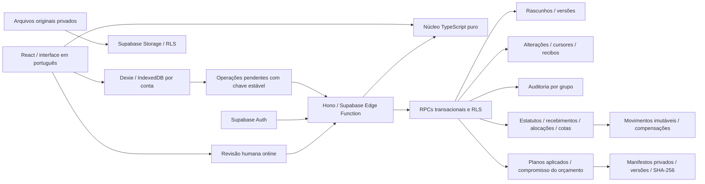

# Arquitetura da aplicação

O navegador é o ambiente de trabalho de cada aparelho. O Supabase é a autoridade compartilhada para identidade, autorização, versões, confirmações financeiras, aplicação de planos e trava de bolões. A fundação descrita aqui inclui o fechamento da etapa 4 da [especificação](ESPECIFICACAO.md); convites, registro externo de apostas, resultados e a entrega A completa continuam pendentes.

## Invariantes

- Valores monetários são strings de centavos, com `bigint` para cálculo; nada de `Number` em dinheiro real. Cotas usam 100 unidades por cota de referência.
- Confirmação humana exige estado online e revisão atual do servidor. Não rebasear silenciosamente uma proposta depois de o usuário ter lido seus dados.
- Persistir comando + resumo antes do POST. Resposta incerta: consultar recibo por GET; eventual reenvio exige autorização explícita do conteúdo original e mantém a mesma chave. Reconexão nunca confirma automaticamente.
- `receiptId` é UUID do servidor e deve ligar exatamente a ação aceita; `idempotencyKey` é outra identidade.
- RLS, verificação da classificação atual em Auth e escopo de conta/grupo permanecem obrigatórios. Não abrir a API humana para agentes como atalho.
- Preservar originais, manifestos e histórias; resultado ausente não é zero; prêmio calculado não é dinheiro recebido.
- A lista do registrador exclui o retrato financeiro completo. Manifesto e demonstrativo são privados; documentos do grupo não são recibos CAIXA.
- Nenhuma mensagem sai sozinha para WhatsApp, email ou outras conversas; o produto prevê copiar/compartilhar texto com aprovação humana.

## Fronteiras e escolhas

| Camada | Responsabilidade | Autoridade |
|---|---|---|
| `packages/core` | Contratos v1, centavos com `bigint`, cotas, catálogos, geração determinística, planos e validação de fatos e manifestos | Calcula saldos e verifica estruturas e hashes; a autorização e os prazos pertencem ao servidor |
| `packages/local` | IndexedDB separado por conta, salvamento imediato, fila, cursores, reconciliação e proteção de pendências | Mantém o trabalho do aparelho e a última versão recebida |
| `apps/web` | Navegação, formulários, revisão de pendências, login, geração de jogos e sincronização | Apresenta dados e decisões do usuário |
| `supabase/functions/api` | Sessão humana validada pelo Auth, CORS explícito, limites de entrada, contratos HTTP e cliente com JWT do usuário | Encaminha comandos; não usa uma chave administrativa |
| PostgreSQL | Membership, dependências, versões, revisão financeira e de planos, idempotência, alterações e auditoria | Aceita cada rascunho ou decisão humana em uma transação |
| Storage | Originais privados identificados por grupo e UUID | Autoriza leitura/upload por membership; originais não têm política de substituição/exclusão |

O núcleo é puro e pode ser usado no navegador, em uma CLI e na função Deno. A função importa o validador original; o `deno.json` resolve explicitamente os imports internos do núcleo. Não existe uma cópia gerada do núcleo no backend. O SQL mantém verificações defensivas equivalentes porque os RPCs também são acessíveis pelo PostgREST, sem passar pelo Hono. Mudanças de catálogo/limites precisam de uma migration correspondente e de testes de concordância.

Os rascunhos usam JSONB com campos permitidos por tipo. O envelope é tipado pelo contrato v1 e o servidor recusa campos extras. Dependências entre pessoas, bolões, cotas e jogos são verificadas no grupo durante a gravação. Estatutos publicados, aceites, recebimentos, alocações, movimentos, cotas confirmadas e revogações possuem tabelas relacionais próprias com chaves estrangeiras e fatos imutáveis. A segunda migration acrescenta as finanças; a terceira acrescenta planos, catálogo completo e manifestos. As migrations anteriores foram preservadas.

## Estados com autoridades diferentes

- Um rascunho local pode ser salvo sem conexão.
- Um rascunho sincronizado possui versão e recibo do servidor; isso comprova o recebimento da edição.
- Um fato financeiro confirmado exige uma operação humana online sobre a revisão atual do grupo.
- Um plano aplicado ou manifesto travado exige revisão humana online, orçamento confirmado e verificação dos jogos e direitos atuais.

`sync_push` aceita somente `group`, `person`, `pool` em `draft`, `quota`, `bet` e `payment-proposal`. Cotas sincronizadas são intenções internas, sem direitos confirmados. Propostas de pagamento mantêm os estados `pending`, `needs-review` ou `rejected` e nunca aumentam o caixa. O endpoint HTTP `review_decide` encaminha decisões financeiras ao RPC financeiro e `plan_apply`/`pool_lock` ao RPC `planning_decide`. Essas decisões não usam a fila de rascunhos. A tabela antiga `confirmed_payments` permanece reservada e sem uso; os recebimentos atuais são transferências do grupo e podem financiar vários bolões.

Uma cota exige declaração de maioridade da pessoa, custo em centavos inteiros e no máximo 200 pessoas com cotas distintas no bolão. Como uma cota vale 100 unidades, o produto do preço em centavos pelas unidades deve ser divisível por 100. Alterar o preço de um bolão revalida todas as suas cotas, e mover uma cota para outro bolão também verifica a capacidade do destino. Essas verificações ocorrem sob o mesmo bloqueio transacional do grupo; uma rejeição não grava a entidade nem avança sua revisão.

## Confirmações financeiras

Cada `FinancialCommand` usa `expectedRevision`, que inclui alterações de rascunhos e financeiras. O SQL obtém o mesmo bloqueio do grupo usado pela sincronização e recusa uma aprovação se a revisão mudou. `groupVersion`, `proposalVersion` e `quotaVersion` ligam a aprovação à versão exata do rascunho correspondente. Sessão humana, papel de organizador e acesso atual ao grupo são obrigatórios também na chamada direta dos RPCs.

O estatuto publicado congela o texto e a versão do cadastro do grupo. Um aceite registra a pessoa, essa versão publicada, a evidência informada pelo organizador, o recibo e o horário do servidor. Novas cotas exigem aceite do estatuto publicado mais recente; publicar regras novas preserva os estatutos e cotas históricos.

Um recebimento registra uma única proposta de origem e sua versão, o pagador, o valor e uma referência bancária opcional. A referência, quando fornecida, é normalizada e única no grupo, inclusive após estorno. A verificação do recebimento é uma decisão do organizador; não há consulta automática ao banco. Cada alocação pertence ao mesmo pagador e transfere parte do saldo não alocado para um bolão do grupo, sem aumentar o caixa novamente. Receber ou alocar pagamento nunca confirma uma cota automaticamente.

A confirmação de uma cota congela unidades, custo, estatuto e versão de origem. Exige financiamento integral confirmado para essa pessoa e bolão, declaração de maioridade, aceite do estatuto atual e horário do servidor estritamente anterior ao prazo. Um prazo ausente bloqueia a confirmação com uma explicação; dinheiro tardio pode ser registrado e alocado, mas não cria uma cota depois do prazo. Há no máximo uma cota confirmada sem revogação por pessoa e bolão. Esses direitos internos servem ao planejamento; o recibo oficial da CAIXA depende do registro externo posterior.

O ledger preserva recebimentos e alocações positivos. `payment_reverse` compensa integralmente o recebimento e todas as suas alocações com movimentos negativos no mesmo recibo e horário. Cotas que perderem financiamento integral recebem revogações imutáveis; cotas que continuarem financiadas são preservadas. O estorno exige bolões alocados ainda em rascunho e não admite novas alocações do recebimento estornado. Um novo recebimento exige nova confirmação explícita da cota, ainda dentro do prazo.

Uma proposta já recebida fica preservada. Cotas ativas impedem edição do rascunho de origem, retirada da declaração de maioridade ou mudança de preço, prazo, modalidade, concurso e tipo de participação do bolão. É permitida somente a primeira definição de concurso ausente e de participação `undecided` para `internal`/`official`, enquanto o bolão estiver em rascunho e sem plano aplicado. Guardas SQL e `sync_push` aplicam essas regras. A sincronização não consegue reabrir um bolão travado.

`finance_pull` captura a revisão e todos os fatos financeiros do grupo em uma consulta SQL, com uma única visão consistente do banco. O núcleo exige arrays completos, correspondência entre fatos e movimentos, compensações integrais e financiamento de cotas sem revogação. Um recibo financeiro aceito contém o retrato dessa revisão e um horário do servidor. Sua repetição devolve o retrato original; consulte o retrato atual antes da próxima decisão. Os UUIDs dos fatos e recibos financeiros são gerados no servidor.

## Planos e manifesto privado

`plan_apply` compara a revisão usada na preparação com a revisão atual do grupo, sem ajustar uma aprovação antiga automaticamente. O SQL confere todos os jogos de rascunho e suas versões, direitos ativos integralmente financiados, aceites, maioridade, concurso, prazo e modalidade. Cotas elegíveis ainda não confirmadas e propostas pendentes bloqueiam a aplicação. Jogos gerados pertencem ao fato do plano; não são inseridos como novos rascunhos fixos.

Cada aplicação acrescenta uma versão sequencial imutável por bolão. O orçamento é a soma dos valores devidos pelos direitos ativos e não pode exceder o financiamento líquido alocado ao bolão. Esse compromisso protege o orçamento contra estornos e não acrescenta recebimento ou alocação ao ledger. A taxa externa declarada e os jogos devem caber nele. A sobra mantém o destino autorizado `refund-pro-rata` ou `group-credit` pendente: a escolha não efetua devolução nem cria crédito de carteira.

O catálogo `caixa-pools-2026-10-08-v1` contém 32 regras por quantidade de números de Mega-Sena, Lotofácil e Quina. O SQL mantém a mesma versão e os testes comparam todas as linhas com o núcleo. Cartelas oficiais precisam respeitar limites específicos, custo em centavos exatos e a proporção econômica de cada participante; cartelas internas têm um jogo e não afirmam emitir cotas oficiais. O limite informado de tarifa lotérica não é aplicado indistintamente à taxa externa declarada. O catálogo permanece uma versão explícita; mudanças de preços ou regras exigem uma nova versão e migration.

`pool_lock` aceita somente o plano aplicado mais recente e reconfere suas fontes e financiamento no relógio do servidor, estritamente antes do prazo. O organizador escolhe um registrador adulto do grupo e, em `internal`, um titular adulto do bilhete; em `official`, esse titular é nulo. A autoria não altera direitos. A trava incrementa a versão do bolão e congela seus dados, pessoas relacionadas, jogos, direitos, referências financeiras, catálogo e responsáveis.

O manifesto guarda o conteúdo, bytes canônicos UTF-8, SHA-256, horário UTC do servidor e recibo. Chaves ordenadas, inteiros seguros e arrays ordenados tornam o hash verificável pelo núcleo e por WebCrypto. Ele é privado: o retrato financeiro completo inclui outros bolões do grupo. O download deve ser tratado como manifesto privado, sem publicação automática. O hash comprova a correspondência com os bytes apresentados, sem provar registro externo ou impedir alterações feitas pelo administrador da infraestrutura.

Antes do prazo e enquanto o bolão não estiver registrado, uma nova aplicação e trava podem acrescentar versões sem reabrir o rascunho. A revisão preserva pessoas, responsáveis, direitos, orçamento e retrato financeiro do manifesto inicial; somente plano, jogos e taxas podem variar dentro desse compromisso. Todos os fatos anteriores permanecem. O registro externo ainda não existe nesta etapa; os estados `registered` e `settled` já bloqueiam essas revisões. `plan_pull` devolve a história completa e `plan_command_status` recupera a decisão original.

## Protocolo de sincronização

Cada comando usa UUID de entidade, grupo, chave de idempotência e `expectedVersion`. A API valida o lote antes de enviá-lo e executa cada comando em uma transação própria, preservando a ordem recebida. Um erro HTTP depois de comandos aceitos pode deixar uma resposta incompleta; o cliente deve repetir os mesmos comandos, com as mesmas chaves e conteúdos.

O SQL bloqueia a chave de idempotência por usuário e o grupo, incluindo o caso em que ainda não existe uma linha do grupo. O comando aceita somente a versão esperada. Quando aceito, grava o registro, incrementa a revisão do grupo e acrescenta a alteração, auditoria e recibo na mesma transação. Repetições iguais retornam o recibo original sem alterar a revisão. A mesma chave com conteúdo diferente é recusada e não sobrescreve o resultado original.

Finanças e planejamento usam tabelas próprias de recibos com a mesma regra de repetição, em namespaces separados por conta e chave. Cada decisão aceita incrementa a revisão e acrescenta auditoria encadeada e um marcador canônico: grupo nas finanças, bolão no planejamento. Uma aplicação não muda a versão da entidade; uma trava muda a versão e o estado do bolão. Os fatos são obtidos por `finance_pull` e `plan_pull`. O `receiptId` aceito de planejamento é gerado no servidor e liga exatamente um plano ou manifesto; não é a chave de idempotência do cliente.

Uma edição antiga retorna `conflict` com a versão corrente autorizada. A reconciliação preserva o trabalho local e exige revisão explícita; não escolhe automaticamente a edição mais recente. Uma operação em conflito ou rejeitada usa uma nova chave quando for corrigida.

`sync_pull` devolve até 200 revisões completas por página e um cursor inteiro. A leitura captura primeiro o último estado já confirmado e limita a página a ele. `hasMore` indica a necessidade de outra chamada; a última página alcança essa revisão, inclusive seus marcadores financeiros e de planejamento. Uma revisão humana deve combinar rascunhos, finanças e planos com revisões iguais e sem pendências locais. Nenhuma migration remove alterações antigas; qualquer futura retenção terá de implementar uma carga completa compatível com as pendências locais antes de ativar a expiração de cursores.

O aparelho novo consulta `GET /v1/groups`, depois lê cada grupo autorizado desde o cursor zero. Realtime será um aviso para buscar o fluxo persistente; não é a fonte de recuperação. Nesta etapa não há publicação Realtime configurada nem tarefas executadas com o app fechado.

## Acesso e isolamento

A primeira criação sincronizada de um grupo exige uma sessão humana e um comando `group` com `entityId = groupId` e `expectedVersion = 0`. Grupo, membership de organizador e primeiro rascunho surgem na mesma transação. Um UUID já pertencente a outro grupo não concede acesso. A autoria vem de `auth.uid()`, não do JSON do cliente.

O papel `organizer` lê e edita os rascunhos do grupo. `participant` e `registrar` são papéis reservados, com acesso apenas ao próprio membership e aos metadados do grupo nesta fundação. Ainda faltam convites vinculados, identidade da pessoa, visões individuais e escopo do registrador; conceder acesso a todos os rascunhos exporia dados de terceiros.

Credenciais delegadas que contêm `client_id`, sessões anônimas, chaves de serviço e contas com `app_metadata.actor_type` diferente de `human` são recusadas. O mesmo bloqueio existe na função, nos RPCs e nas políticas RLS. O SQL verifica a classificação atual da conta em `auth.users`, além das claims, para recusar um token humano antigo após uma mudança para agente. OAuth do agente, concessões por grupo e revogação serão implementados na etapa do agente. Uma cópia da sessão humana continua sendo indistinguível do token original e não serve como integração de agente.

A auditoria registra apenas identificadores, versões e ação, sem copiar nomes ou dados de pagamentos. Seu hash encadeado ajuda a detectar mudanças, mas um administrador da infraestrutura pode alterar a instalação e não fica impedido por essa técnica. Não é prova absoluta de integridade externa.

## Próximas fronteiras do plano

| Etapa | Trabalho ainda necessário |
|---|---|
| Administração | Convites vinculados, visões individuais e de registrador, conciliação bancária e evidências de arquivo vinculadas |
| Jogos e planos | Atualizações e exceções de catálogo por concurso, probabilidades de carteiras e simulações ampliadas |
| Registro e resultado | Evidências com hash e referências, conferência do registrador, coleta da Caixa e revisões de resultados |
| Distribuição | Direitos do manifesto de fechamento, resgates, prêmios, rateio e movimentos compensatórios da distribuição |
| Agente e importação | OAuth delegado, permissões revogáveis, MCP/CLI, propostas e aprovação humana com o mesmo servidor |
| Recuperação e piloto | Backup criptografado com arquivos, restauração verificada, retenção, dispositivos reais e publicação explicitamente autorizada |

## Validação

O backend possui testes Deno para validação compartilhada, identidade humana, CORS e encaminhamento dos endpoints financeiros e de planejamento. Os testes SQL cobrem idempotência, conflitos, isolamento, escrita proibida, paginação, auditoria, cotas, pagamentos, alocações, estatutos, prazos, estornos, planos, travas e revisões preservadas. O runner PGlite aplica todas as migrations em ordem, valida respostas financeiras e de planejamento reais pelo núcleo TypeScript, compara as 32 regras do catálogo e confere hashes dos manifestos com uma implementação independente.

PGlite usa schemas mínimos de Auth/Storage, e os testes HTTP da função usam transporte de Auth simulado. Eles verificam lógica e contratos, mas não comprovam integração com Supabase Auth, OAuth Google, Storage HTTP, Edge↔PostgREST nem concorrência entre conexões reais. Essa integração permanece necessária antes de uma publicação. Nenhum deploy foi executado.
