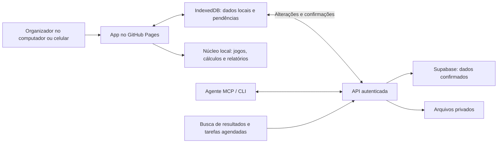

# Bolão — especificação completa com funcionamento local e sincronização
**Projeto:** Little Faith App · **Data:** 07/10/2026  
**Destino do plano:** `docs/ESPECIFICACAO.md`

## 1. Produto e decisões consolidadas

Construir um app para administrar bolões privados de loterias brasileiras a partir de qualquer país, pelo computador ou celular. O organizador poderá trabalhar manualmente ou com um agente externo; os participantes poderão continuar usando apenas o WhatsApp.

**Decisão central: o app trabalha primeiro com os dados locais e sincroniza com o Supabase.** Navegação, edição de rascunhos, geração de jogos, simulações e relatórios acontecem no aparelho. Pagamentos, cotas, aplicação de planos e fechamento de bolões precisam de conexão para a confirmação definitiva.

### Decisões já tomadas

| Tema | Escolha |
|---|---|
| Publicação | GitHub Pages |
| Formato | Aplicação web responsiva, instalável como PWA |
| Dados locais | IndexedDB, acessado por Dexie |
| Sincronização | Supabase Free |
| Público principal | Organizador que administra os participantes |
| Conta dos participantes | Opcional |
| Modalidades iniciais | Mega-Sena, Lotofácil e Quina |
| Uso internacional | Administrar loterias brasileiras de qualquer localização |
| Dinheiro e apresentação | Reais, interface inicial em português |
| Aparência | Colorida, descontraída e clara |
| IA | Agente externo conectado por MCP; nenhuma contratação obrigatória de API de IA |
| Operação offline | Preparar e calcular localmente; confirmar operações financeiras online |
| Registro das apostas | Feito externamente por um registrador |
| WhatsApp inicial | Importação, texto colado e mensagens preparadas para envio aprovado |

“Local” significa **no aparelho que estiver usando**, inclusive celular. O app não dependerá de um Mac ligado, servidor doméstico ou instalação de SQLite para funcionar.

GitHub Pages servirá a aplicação estática. Supabase fornecerá autenticação, dados compartilhados, arquivos privados, validações e tarefas necessárias quando ninguém estiver com o app aberto. [GitHub Pages](https://docs.github.com/en/pages/getting-started-with-github-pages/what-is-github-pages).

### Entregas, sem perder o conteúdo original

| Entrega | Conteúdo |
|---|---|
| **A — operação completa inicial** | Três modalidades, funcionamento local, sincronização, pessoas, grupos, estatuto básico, cotas, pagamentos, jogos, planejamento, revisão, registrador, recibos, resultados, rateio, histórico básico, links de acompanhamento, MCP/CLI e recuperação de backup |
| **B — administração completa** | Carteira, recorrência, Teimosinha, processamento de mídia, relatórios anuais, limites de gasto, notificações opcionais e fechamentos verificados da Lotofácil |
| **C — expansão** | Demais modalidades, integração contínua opcional com WhatsApp e apresentação 3D |

O app administra grupos existentes. Não venderá cotas ao público, custodiará dinheiro, fará transferências bancárias ou registrará apostas automaticamente. Esse recorte também orienta o uso do GitHub Pages, cujas regras restringem comércio e serviços comerciais. [Limites do GitHub Pages](https://docs.github.com/en/pages/getting-started-with-github-pages/github-pages-limits).

### Correções da especificação original

- Substituir a dependência de SQLite no Mac por armazenamento local em cada navegador, sincronizado.
- Usar limites oficiais por modalidade **e quantidade de números**, evitando uma regra universal de “100 cotas e 10 apostas”.
- Calcular probabilidades considerando combinações repetidas e sobrepostas.
- Separar estimativas, pagamentos confirmados, prêmios apurados e dinheiro efetivamente recebido.
- Tratar comprovante de Pix como evidência a revisar.
- Separar autoria dos números de direito ao prêmio.
- Diferenciar recibo oficial de cota e demonstrativo produzido pelo app.
- Versionar preços, calendários e exceções por concurso.
- Não apresentar hash e horário do servidor como prova absoluta contra alterações feitas pelo administrador da infraestrutura.
- Incluir arquivos e pendências locais no processo de recuperação.

## 2. Experiência e interface

### Papéis

| Papel | Responsabilidade |
|---|---|
| Organizador | Administra o grupo, confirma lançamentos, escolhe planos e acompanha o encerramento |
| Registrador | Recebe a lista de apostas, registra externamente e devolve comprovantes |
| Participante sem conta | Participa pelo WhatsApp e recebe informações e demonstrativos |
| Participante com conta | Acompanha suas informações privadas mediante convite vinculado |
| Agente | Interpreta informações, propõe alterações, consulta dados permitidos e prepara mensagens |
| Responsável pela instalação | Configura publicação, credenciais, manutenção e backups |

Pessoa cadastrada no bolão e usuário autenticado serão conceitos distintos. Cadastrar alguém não exigirá criar conta.

### Estrutura de navegação

No celular: **Início, Bolões, Revisão e Histórico** na navegação inferior. No computador: os mesmos destinos em uma barra lateral.

Grupo e bolão atuais permanecerão visíveis. Dados financeiros de grupos diferentes nunca serão somados como um caixa único.

| Tela | Pergunta principal | Conteúdo |
|---|---|---|
| Início | O que precisa da minha atenção? | Próximos prazos, caixa confirmado, pendências, revisão e sincronização |
| Bolões | Qual bolão estou administrando? | Lista por grupo, modalidade, concurso e estado |
| Resumo do bolão | Quanto temos e o que falta? | Arrecadação, custos, participantes, prazos e próxima ação |
| Pessoas e cotas | Quem participa e com qual direito? | Cotas, valor devido, pagamento e origem dos números |
| Jogos | O que vamos jogar? | Volantes, autoria, duplicatas, cartelas e custo |
| Planejador | Como usar esse orçamento? | Planos viáveis, probabilidades, taxas, sobras e comparação |
| Revisão | O que foi entendido e o que vai mudar? | Original, interpretação, diferenças e efeitos |
| Registro | O que foi realmente apostado? | Checklist, recibos e divergências |
| Resultado | Quais jogos acertaram? | Conferência por jogo, cartela e autoria |
| Rateio | Quanto cabe a cada pessoa? | Direito, valor recebido, distribuído e pendente |
| Histórico | Como o grupo está financeiramente? | Investimento, taxas, prêmios, distribuição e saldo |
| Dados e integrações | Os dados estão protegidos e atualizados? | Sincronização, dispositivos, agente, exportação e recuperação |

### Comportamento local e estados visíveis

O app abrirá usando os dados disponíveis no aparelho, sem esperar a rede.

Cada operação terá um estado compreensível:

- **Salvo neste aparelho:** ainda não enviado.
- **Aguardando sincronização:** pode ser enviado quando houver conexão.
- **Sincronizado:** recebido pelo Supabase.
- **Aguardando confirmação:** proposta disponível para decisão humana.
- **Confirmado:** operação aceita e registrada.
- **Precisa de revisão:** houve conflito, mudança de regra ou rejeição.

Uma proposta de pagamento não aumentará o saldo disponível. Um fechamento preparado offline não aparecerá como fechado.

A interface mostrará a última sincronização e avisará quando estiver exibindo uma versão antiga. O botão **Sincronizar agora** complementará o funcionamento automático.

### Fluxo principal

1. Entrar, criar um grupo e definir as regras.
2. Criar o bolão e cadastrar participantes manualmente ou por importação.
3. Preparar cotas, pagamentos e jogos.
4. Conectar, revisar e confirmar os lançamentos.
5. Escolher um plano compatível com o dinheiro confirmado.
6. Travar participantes, direitos e jogos antes do registro.
7. Entregar a lista ao registrador e conferir os recibos.
8. Buscar resultados e apurar os prêmios.
9. Confirmar resgate e distribuição.
10. Encerrar com todas as diferenças explicadas.

A confirmação de uma ação manual será integrada à própria tela. O organizador não precisará lançar um pagamento e depois procurar uma segunda fila para confirmar a mesma ação.

### Direção visual e acessibilidade

- Tema escuro desde o início (direção "Noite do sorteio", escolha dele em 10/10); uma opção clara fica para depois.
- Violeta como identidade principal e cores próprias das modalidades.
- Verde para confirmado, âmbar para pendência e vermelho para problema, sempre acompanhados de texto.
- Uma ação principal por tela.
- Valores com algarismos tabulares e dezenas alinhadas.
- Áreas de toque de pelo menos 44 px, contraste AA, teclado e foco visível.
- Layout funcional a partir de 320 px.
- Movimento reduzido respeitado em toda a aplicação.
- Motion e SVG para transições, volante, revelação de resultados e explicação do rateio.
- 3D carregado somente na entrega C, com alternativa 2D completa.

Meta de desempenho: mostrar a primeira tela com dados já armazenados em menos de um segundo nos aparelhos de referência. Simulações acontecerão em worker, sem bloquear a interface.

### Acompanhamento dos participantes

O link do grupo mostrará informações agregadas, jogos confirmados e estado do bolão. Nomes, cotas e valores individuais só serão publicados quando houver autorização registrada.

Telefone, CPF, chave Pix, cobranças individuais e imagens originais de bilhetes não entrarão na página compartilhada.

Informações privadas poderão ser acessadas por conta opcional vinculada por convite ou entregues em demonstrativo individual. A vinculação não será feita automaticamente por nome semelhante.

Links serão revogáveis. A prévia do WhatsApp será genérica; o app também produzirá uma imagem compartilhável do bolão. Uma página dinâmica em GitHub Pages não garante uma prévia personalizada para cada link.

## 3. Regras e módulos funcionais

### Pessoas, grupos e estatuto

- Pessoas terão identificadores próprios, apelidos e referências de origem por grupo.
- Correspondências aproximadas serão sugestões para revisão.
- Fusão de pessoas exigirá confirmação e preservará referências e direitos já congelados.
- Cada grupo terá caixa, participantes, permissões e regras separados.
- Estatutos serão versionados, com registro do aceite pelo app ou da evidência informada pelo organizador.

O estatuto definirá prazo, inadimplência, cotas, sobras, taxas externas, créditos, registro, divisão e responsabilidade pelos comprovantes.

Padrões iniciais:

- Participação válida exige pagamento integral confirmado até o prazo.
- Pagamento parcial não cria automaticamente uma cota menor.
- Adiantamento do organizador precisa de lançamento e regra explícitos.
- Autoria de números não altera o direito ao prêmio.
- Sobras permanecem identificadas até devolução ou destino autorizado.
- Mudanças de estatuto valem para novas operações; não reescrevem direitos anteriores.
- Participantes precisam ter a declaração de maioridade registrada.

### Cotas e modalidades de participação

Cotas internas poderão ser desiguais e fracionadas, com até duas casas decimais. O núcleo representará uma cota como 100 unidades inteiras.

Será necessário distinguir:

1. **Participação interna:** acordo econômico do grupo.
2. **Cota oficial:** direito emitido no recibo da Caixa.
3. **Titular do bilhete:** pessoa responsável por um registro informal.

No modo oficial, o plano só será considerado compatível quando os direitos puderem ser representados pelos recibos de cada bilhete. Fracionamento interno não será apresentado como cota oficial fracionada.

Quando a estrutura não couber nas regras oficiais, o app explicará a incompatibilidade e oferecerá revisão do plano. A adoção de um acordo informal exigirá escolha explícita.

### Dinheiro e pagamentos

- Todos os valores serão calculados em centavos inteiros.
- Campos monetários da API usarão strings de centavos inteiros.
- Nenhum registro financeiro confirmado será apagado; correções acontecerão por estorno ou movimento compensatório.
- Uma transferência poderá ser alocada a vários bolões do mesmo grupo.
- A soma das alocações nunca excederá o valor confirmado.
- Pagamentos parciais, excedentes, atrasados e devoluções serão tratados separadamente.
- Comprovantes poderão sugerir valor, data e pagador, mas dependerão de confirmação.
- Referências bancárias disponíveis ajudarão a detectar repetição.

O saldo utilizável considerará entradas confirmadas, reservas, devoluções, taxas e compromissos com outros bolões.

O app poderá gerar Pix copia e cola e QR estático com o valor informado. Não acessará credenciais bancárias nem confirmará liquidação apenas pela imagem.

Antes de confirmar pagamento, cota, reserva, plano ou distribuição, o servidor verificará a versão atual e aplicará a operação em uma transação.

### Jogos e cartelas

- Validar quantidade, intervalo e campos adicionais conforme a modalidade.
- Bloquear duplicata exata dentro do bolão.
- Permitir associar mais de um autor a um jogo existente, sem duplicar custo.
- Alertar sobre repetição em outros bolões acessíveis do mesmo concurso.
- Preservar jogos e números fixos enviados pelos participantes.
- Mostrar sobreposição entre apostas ampliadas.
- Separar autoria, cartela, registro e direito econômico.
- Empacotar apostas respeitando as regras oficiais de cada cartela.

O catálogo será versionado e conterá preços, quantidade de números, cotas, limites, taxas permitidas e vigência. As três modalidades iniciais partirão dos valores oficiais verificados: Mega-Sena R$ 6,00, Lotofácil R$ 3,50 e Quina R$ 3,00 por aposta simples. [Mega-Sena](https://loterias.caixa.gov.br/Paginas/Mega-Sena.aspx), [Lotofácil](https://loterias.caixa.gov.br/Paginas/Lotofacil.aspx), [Quina](https://loterias.caixa.gov.br/Paginas/Quina.aspx).

Planos offline usarão a versão local do catálogo e serão revalidados antes de aplicação.

### Planejamento e matemática

O planejador receberá orçamento confirmado, participantes, direitos, jogos fixos, modalidade, concurso, taxas e restrições.

Produzirá até três alternativas viáveis:

- **Espalhada:** prioriza diversidade entre apostas.
- **Equilibrada:** combina diversidade e concentração.
- **Concentrada:** prioriza apostas ampliadas.

Não inventará três opções quando apenas uma ou duas forem viáveis.

Cada plano mostrará:

- Jogos e cartelas.
- Custo das apostas e taxas.
- Sobras e destino proposto.
- Correspondência entre participação interna e cotas oficiais.
- Combinações elementares distintas e sobreposição.
- Probabilidade por faixa e de obter ao menos um prêmio.
- Método de cálculo e limitações.
- Explicação curta das escolhas.

A seleção comparará candidatos viáveis, sem prometer um ótimo global quando a busca for limitada.

Regras matemáticas:

- Usar cálculo combinatório exato para apostas individuais.
- Considerar a união das combinações distintas na chance do prêmio principal.
- Não somar probabilidades individuais para obter a chance conjunta de algum prêmio.
- Usar Monte Carlo para carteiras complexas, com intervalo de confiança de 95%.
- Começar com 200 mil amostras e permitir refinamento até um milhão.
- Mostrar que zero ocorrências na simulação não significa probabilidade zero.
- Registrar algoritmo, versão, semente, amostras e entradas.
- Não prometer retorno fixo por R$ 100 apostados.
- Não descontar imposto novamente sobre um valor que já tenha sido informado como líquido.

Simulações extensas rodarão no aparelho ou na CLI, com progresso, cancelamento e retomada.

A geração de números terá semente criptográfica de 256 bits e algoritmo determinístico versionado, reproduzível no navegador e na CLI. Filtros opcionais atuarão apenas nos jogos gerados e não prometerão menor divisão de prêmio sem dados que sustentem a afirmação.

### Trava e prova de registro

O fechamento confirmado congelará:

- Participantes e direitos.
- Pagamentos e alocações aceitos.
- Jogos e plano.
- Regras e preços utilizados.
- Taxas, responsáveis e prazos.

O servidor produzirá um manifesto canônico com hash SHA-256 e horário de confirmação. O documento poderá ser baixado e compartilhado antes do sorteio.

Antes do registro externo e dentro do prazo, uma revisão poderá produzir nova versão, preservando a anterior como substituída. Depois do registro, os direitos não poderão ser alterados silenciosamente.

O registrador receberá lista de jogos, cartelas, concurso, custo esperado e checklist.

Cada comprovante guardará original privado, hash, horário de recebimento e dados extraídos. A conferência distinguirá:

- Jogo planejado.
- Jogo comprovadamente registrado.
- Divergência.
- Registro parcial.
- Comprovante apresentado depois do prazo.

Leitura de recibo feita pelo agente criará uma proposta. A validação final será humana. Divergências ficarão visíveis e não apagarão a versão planejada.

### Resultados, calendário e fusos

A fonte primária será o serviço JSON da Caixa. Cada consulta relevante guardará origem, conteúdo bruto, hash e horário de coleta.

Estados distintos:

- Aguardando números.
- Números disponíveis, rateio pendente.
- Resultado completo.
- Resultado informado manualmente.
- Conflito entre versões.

O app manterá o último resultado válido quando houver falha e nunca converterá ausência de informação em prêmio zero.

Para concursos acompanhados, o backend iniciará consultas no horário previsto, repetirá a cada cinco minutos durante a janela inicial e reduzirá a frequência depois de 24 horas. Haverá nova conferência na manhã seguinte.

Resultados poderão ser informados manualmente com fonte e aprovação. Uma resposta posterior incompatível da Caixa abrirá revisão.

Horários e exceções ficarão em configuração por concurso. O prazo interno do grupo será separado do encerramento do canal de registro e do horário do sorteio. [Calendário oficial](https://loterias.caixa.gov.br/Paginas/regras-sorteios.aspx).

Datas serão armazenadas em UTC. A interface mostrará Brasília e o fuso atual do usuário, detectado pelo aparelho e ajustável. Não haverá diferença fixa entre Brasília e Minneapolis.

O servidor decidirá se uma confirmação ocorreu dentro do prazo; o relógio do aparelho não poderá autorizar fechamento atrasado.

### Apuração e rateio

Separar claramente:

1. Prêmio calculado a partir do resultado.
2. Prêmio confirmado.
3. Dinheiro resgatado.
4. Direito de cada pessoa.
5. Valor distribuído ou recebido individualmente.
6. Pendência restante.

Apostas ampliadas poderão gerar múltiplos prêmios. A conferência calculará essa multiplicidade.

No rateio interno, centavos residuais serão distribuídos pelo método dos maiores restos, com desempate estável pelo identificador congelado do participante.

No bolão oficial, prevalecerão valores e direitos dos recibos emitidos. Resgate individual não será registrado como entrada de dinheiro no caixa do organizador.

No informal, o app acompanhará recebimento pelo titular e distribuição parcial ou total aos participantes.

Demonstrativos gerados pelo app serão identificados como documentos do grupo. Não serão apresentados como recibos da Caixa ou documento fiscal oficial.

Alertas de resgate serão preparados para 30, 15, 7 e 1 dia antes do prazo aplicável. A regra geral de 90 dias ficará associada à fonte oficial e poderá receber exceções documentadas. [Recebimento de prêmios](https://loterias.caixa.gov.br/Paginas/receba-seu-premio.aspx).

Encerrar um bolão exigirá explicar dinheiro, sobras, devoluções e pendências, inclusive quando não houver prêmio.

### WhatsApp, revisão e mensagens

Todos os canais alimentarão o mesmo processo:

**Origem → interpretação → validação → proposta → decisão humana → registro confirmado.**

Entradas iniciais:

- Texto colado.
- Exportação `.txt`.
- Exportação `.zip`.
- Mensagens encaminhadas por agente autorizado.
- Dados estruturados extraídos por agente externo.

A revisão mostrará mensagem original, autor, horário, interpretação, confiança, validações e efeitos financeiros.

Exports sem identificador real de mensagem usarão assinatura de conteúdo e contexto. Casos ambíguos irão para revisão. Reimportar não deverá duplicar lançamentos.

Pedidos como “os mesmos números da semana passada” exigirão referência inequívoca ao bolão ou jogo anterior.

Mensagens de WhatsApp serão tratadas como dados, inclusive quando contiverem instruções dirigidas ao agente.

Modelos iniciais:

- Abertura.
- Cobrança.
- Travamento.
- Registro confirmado.
- Resultado.
- Rateio e encerramento.

Cada mensagem terá conteúdo e destino aprovados. Estados: rascunho, aprovado, envio declarado, falhou ou resultado desconhecido. Envio desconhecido não será repetido automaticamente.

Na entrega A, o organizador copiará ou compartilhará o texto. Integração contínua será opcional na entrega C e seguirá os mesmos contratos e aprovações.

### Funcionalidades completas da entrega B

| Funcionalidade | Especificação |
|---|---|
| Carteira | Crédito por pessoa e grupo, apoiado em dinheiro identificado. Usar crédito não cria nova entrada de caixa. Reserva e débito serão atômicos; saldo negativo e uso duplicado serão bloqueados |
| Recorrência | Série vinculada a bolões individuais por concurso. Pré-pagamento será alocado por ciclo. Mudanças de preço e regras exigirão revisão antes do próximo fechamento |
| Teimosinha | Lista explícita dos concursos cobertos e comprovante correspondente. Direitos congelados na compra; conferência separada de cada concurso |
| Repetição de jogos | Cópia com origem identificada, novo concurso e nova validação de preço, formato e direitos |
| Áudio e imagem | Associação dos arquivos às mensagens; agente externo devolve transcrição ou extração estruturada com referência ao original. Revisão permanece disponível |
| Relatório anual | Investimento, taxas, prêmios, créditos, resgates e distribuições por pessoa. CPF opcional e restrito; documentos oficiais poderão ser anexados |
| Limites de gasto | Limite mensal opcional por pessoa, considerando valores comprometidos e gastos. Visível somente para a pessoa e organizador |
| Fechamentos da Lotofácil | Garantia condicional exibida apenas após verificação exaustiva pelo núcleo, com entradas, condição, custo, versão e certificado reproduzível |
| Sorteio de participantes | Lista elegível congelada, compromisso da semente publicado antes e revelação posterior, permitindo reprodução |
| Histórico ampliado | Relatórios por período e indicadores recreativos opcionais, sem estímulo a aumentar apostas |
| Notificações | Preferências por usuário e Web Push opcional onde suportado; notificações no app serão a base comum |

A verificação de um fechamento executada no aparelho será identificada dessa forma. O app não atribuirá ao servidor uma verificação que ele não realizou.

### Expansão da entrega C

| Modalidade | Particularidade obrigatória |
|---|---|
| Dupla Sena | Dois sorteios e apuração separada por sorteio |
| Dia de Sorte | Dezenas e mês da sorte |
| +Milionária | Dezenas e trevos, com validação e custo próprios |
| Timemania | Dezenas e time do coração |
| Super Sete | Seleções por coluna; repetição entre colunas não é duplicata |
| Lotomania | Universo que inclui zero, aposta de tamanho fixo, faixa de zero acertos e aposta espelho separada |
| Loteca | Programação oficial dos 14 jogos, resultados 1/X/2, duplos, triplos e regras para partidas alteradas |

Cada modalidade só será ativada após catálogo oficial, cálculo de custo, conferência e testes próprios. Na Loteca, confiança informada pelo grupo não será apresentada como probabilidade esportiva comprovada.

## 4. Arquitetura, sincronização e interfaces

### Distribuição do trabalho

### Stack

| Camada | Escolha |
|---|---|
| Linguagem | TypeScript estrito |
| Organização | Monorepo com npm workspaces e lockfile |
| Interface | React, Vite, CSS, Motion e SVG |
| Núcleo | Pacote puro compartilhado, sem acesso direto a rede ou banco |
| Banco local | IndexedDB com Dexie e consultas reativas |
| Cálculo pesado | Web Worker e CLI |
| API | Hono em Supabase Edge Functions |
| MCP | Servidor remoto autenticado com transporte compatível |
| Dados compartilhados | PostgreSQL, Auth, Storage e Realtime do Supabase |
| Backup | ZIP com AES-256 usando zip.js |
| Verificação | Vitest, testes de banco/permissões e Playwright |

Dexie fornecerá persistência local e atualização reativa da interface. A sincronização com Supabase será implementada pelo projeto; não dependerá de Dexie Cloud ou outro serviço pago. [Dexie com React](https://dexie.org/docs/Tutorial/React).

O mesmo núcleo calculará dinheiro, jogos e rateio nos diferentes ambientes. O servidor repetirá as validações necessárias para aceitar uma operação.

### Dados locais

O banco local conterá:

- Cópia dos dados sincronizados permitidos à conta.
- Rascunhos separados dos registros confirmados.
- Propostas preparadas.
- Fila persistente de operações.
- Recibos de sincronização e rejeição.
- Arquivos ainda não enviados.
- Catálogo e resultados já consultados.
- Progresso e checkpoints das análises.
- Cursores de sincronização e versão do esquema.

Salvar um rascunho e sua operação pendente acontecerá na mesma transação local. A interface só mostrará “salvo” depois da conclusão dessa transação.

Banco e caches terão nomes próprios por aplicação, instalação e conta. A troca de usuário não reutilizará dados privados de outra conta.

### Política de sincronização

1. A primeira entrada e a recuperação em aparelho novo exigem internet.
2. Depois da carga inicial, a interface consulta o banco local.
3. Rascunhos são gravados imediatamente.
4. Com conexão e app aberto, a sincronização acontece ao iniciar, retomar, reconectar e após alterações, agrupadas com pequeno atraso.
5. Realtime funciona como aviso para buscar novidades.
6. A recuperação de alterações depende de um cursor persistente.
7. Enquanto houver bolão ativo e app em primeiro plano, uma verificação periódica complementará os avisos.
8. Cada operação só sai da fila depois de receber confirmação identificável do servidor.
9. Falha de rede usa repetição com espera progressiva; conflito ou falha de validação exige revisão.
10. Uma pendência bloqueada não impedirá sincronizar operações independentes.

Realtime, isoladamente, não mantém uma réplica durável do banco local. [Documentação do Supabase](https://supabase.com/docs/guides/database/replication).

Sincronização com o navegador fechado será uma melhoria quando suportada. O funcionamento básico dependerá de abrir ou retomar o app, pois Background Sync não é uniforme entre navegadores. [Compatibilidade](https://developer.mozilla.org/en-US/docs/Web/API/Background_Synchronization_API).

### Confirmações e conflitos

**Preparar offline não será confirmar offline.**

Ao conectar, o app poderá enviar a proposta para revisão. Confirmar exigirá uma decisão humana online, sobre os dados atuais.

O servidor verificará identidade, papel, escopo, versões, prazo, saldo, regras, duplicatas e dependências.

- Operações repetidas usarão a mesma chave de idempotência.
- Repetir uma chamada aceita devolverá o recibo original.
- Reutilizar a chave com conteúdo diferente será rejeitado.
- Edição baseada em versão antiga produzirá conflito explícito.
- A tela mostrará versão anterior, versão atual e alteração preparada.
- Nenhuma alteração financeira será conciliada pelo critério “a última vence”.
- Uma nova aprovação será necessária quando a atualização mudar os efeitos da operação.

A gravação financeira, seu recibo, a revisão das entidades e a auditoria acontecerão na mesma transação.

O fluxo de alterações terá revisão monotônica por grupo, produzida sob bloqueio transacional do grupo. A leitura devolverá somente revisões completas e já confirmadas. [Bloqueios transacionais do PostgreSQL](https://www.postgresql.org/docs/17/explicit-locking.html).

Cursores antigos demais poderão exigir nova carga. Essa carga preservará os rascunhos locais e reapresentará conflitos; não apagará pendências.

### Arquivos e armazenamento

- Original de comprovante: privado no Supabase Storage.
- Arquivo criado offline: pendente no IndexedDB até upload confirmado.
- Miniaturas: disponíveis localmente conforme uso.
- Originais sincronizados: baixados sob demanda ou por escolha de disponibilização offline.
- Uma proposta que depende de comprovante não será confirmada sem o arquivo necessário.
- Evicção do cache removerá somente arquivos já sincronizados; nunca pendências deliberadamente.
- Falta de espaço produzirá erro claro antes de declarar sucesso.

O app solicitará armazenamento persistente quando disponível e mostrará uso estimado. Isso não substitui backup e não impede o usuário de apagar os dados do navegador. [Armazenamento e persistência](https://developer.mozilla.org/en-US/docs/Web/API/Storage_API/Storage_quotas_and_eviction_criteria).

Ao sair da conta com trabalho pendente, haverá opções de sincronizar, exportar uma cópia protegida ou descartar explicitamente. O app não apagará silenciosamente esse trabalho.

### Entidades e versões

| Conjunto | Entidades principais |
|---|---|
| Identidade e acesso | Grupos, pessoas, apelidos, membros, convites e permissões do agente |
| Regras | Estatutos, aceites, versões das modalidades e calendários |
| Operação | Bolões, cotas, pagamentos, alocações, reservas e movimentos financeiros |
| Planejamento | Jogos, cartelas planejadas, planos, análises e manifestos congelados |
| Registro | Bilhetes, evidências e correspondência entre cotas e recibos oficiais |
| Conferência | Concursos, versões dos resultados, acertos e apurações |
| Distribuição | Direitos, resgates, pagamentos de prêmio e pendências |
| Agente | Mensagens, mídias, interpretações, propostas, decisões e mensagens de saída |
| Infraestrutura | Auditoria, recibos de comandos, alterações de sincronização, links, alertas e backups |

Carteira, séries, limites e certificados específicos serão adicionados quando suas entregas forem implementadas.

Identificadores serão UUID. Horários confirmados serão UTC do servidor. Horário declarado do evento e horário do aparelho serão campos separados.

Auditoria confirmada será somente acréscimo, com encadeamento de hashes por grupo. Dados pessoais sensíveis não serão copiados integralmente para esse registro.

### Contratos públicos

Todas as operações usarão a versão `v1` e o mesmo vocabulário entre interface, MCP e CLI.

Comandos incluirão:

- Grupo e entidades envolvidos.
- Chave de idempotência.
- Versões esperadas.
- Dados da operação.
- Referências de origem.
- Opção `dry_run`.

A identidade do autor virá da autenticação, nunca de um campo enviado pelo cliente.

| Interface | Comportamento |
|---|---|
| `sync_pull` | Recebe cursores e retorna alterações autorizadas, versões e próximo cursor |
| `sync_push` | Envia rascunhos, propostas e alterações permitidas; retorna recibo por operação |
| `review_decide` | Confirma, corrige ou rejeita uma proposta com identidade humana autorizada |
| `command_status` | Recupera o resultado de uma operação cuja resposta foi perdida |
| `analysis_get` | Consulta estado, método, progresso e resultado de uma análise |

`sync_push` não poderá promover uma proposta financeira para fato apenas porque o aparelho a marcou como aprovada.

### Ferramentas do agente e CLI

| Família | Operações |
|---|---|
| Consulta | `group_list`, `pool_get`, `rules_get` |
| Entrada e revisão | `inbox_ingest`, `review_list` |
| Pessoas | `person_upsert`, `person_merge` |
| Bolões e cotas | `pool_create`, `pool_lock`, `quota_set` |
| Pagamentos | `payment_record`, `payment_match`, `payment_allocate` |
| Jogos | `bet_add`, `bet_replace` |
| Planejamento | `plan_suggest`, `analysis_get`, `plan_apply` |
| Registro | `ticket_attach`, `ticket_extract_submit` |
| Resultados | `results_sync`, `results_check` |
| Rateio | `payout_compute`, `payout_mark_paid` |
| Mensagens | `message_draft`, `outbox_get_approved`, `outbox_report_sent` |
| Recuperação | `export_backup`, conforme permissão |
| Entrega B | `wallet_apply`, `series_create`, `series_allocate` |

Operações do agente sobre dinheiro, jogos, fusões e fechamento criarão propostas. A credencial do agente não terá acesso a `review_decide`.

O agente remoto enxergará os dados sincronizados e propostas disponíveis no servidor. Rascunhos que existem apenas em um aparelho permanecerão locais até serem enviados.

A CLI `bolao`, com saída `--json`, usará a mesma API e poderá executar cálculos sobre uma entrada local exportada. Não dependerá de acessar diretamente o IndexedDB de um navegador.

`plan_suggest` poderá devolver candidatos leves ou uma tarefa de análise. Simulações extensas serão executadas no app aberto ou na CLI e persistidas depois. Sem executor disponível, o resultado permanecerá pendente, sem probabilidades inventadas.

### Segurança, acesso e privacidade

- Login inicial do organizador por Google.
- Participantes autenticados por convite vinculado.
- Agente com OAuth, escopo por grupo e permissões revogáveis.
- Credencial do agente distinguida da sessão humana.
- RLS e permissões de banco protegendo leituras e dados privados.
- Operações financeiras aceitas somente pelo caminho validado.
- Chaves administrativas e segredos somente no servidor.
- URLs temporárias para arquivos privados.
- Links de acompanhamento aleatórios, armazenados por hash e revogáveis.
- Nenhum dado privado de grupo no bundle ou repositório publicado.
- Mensagens brutas com retenção padrão de 90 dias.
- Evidências financeiras separadas dessa limpeza automática.
- Exclusão ou anonimização de dados pessoais preservando obrigações financeiras necessárias.

A revogação será aplicada na próxima conexão. O app não prometerá apagar instantaneamente uma cópia já disponível num aparelho offline.

Supabase Auth permite o uso de OAuth para agentes; a autorização específica do bolão continuará sendo implementada pelo app. [OAuth no Supabase](https://supabase.com/docs/guides/auth/oauth-server).

### Publicação e limites operacionais

- Vite com base relativa e rotas por hash.
- Service worker e caches limitados ao caminho da aplicação.
- Retorno do login compatível com o endereço publicado.
- Atualização do app e migração local sem apagar pendências.
- Dados demonstrativos identificados e separados dos reais.
- Nada depende da localização atual do usuário.

Capacidade inicial para dimensionamento e testes: 200 pessoas e 1.000 apostas por bolão; arquivo individual de até 10 MB; importação ZIP de até 50 MB compactados, 100 MB expandidos e 500 entradas. Esses limites operacionais são separados das regras da Caixa.

Imports rejeitarão caminhos inválidos, expansão excessiva e arquivos não suportados.

O painel operacional mostrará conexão, saúde do backend, uso de armazenamento, tarefas e último backup. Supabase Free tem cotas e possibilidade de pausa por inatividade; não será apresentado como serviço ilimitado. [Plano Free](https://supabase.com/pricing).

## 5. Backup, implementação e aceitação

### Recuperação de dados

Haverá três níveis complementares:

| Nível | Conteúdo |
|---|---|
| Cópia local de emergência | Rascunhos, operações pendentes, arquivos locais, versões e cursores |
| Exportação completa do grupo | Dados sincronizados, estatutos, manifestos, auditoria, arquivos e hashes |
| Backup automático da instalação | Banco e arquivos referenciados, exportados fora do Supabase |

Exportações completas serão ZIPs protegidos com AES-256. Nomes de arquivos usarão identificadores; a senha ou chave de recuperação ficará sob controle do responsável. [zip.js](https://gildas-lormeau.github.io/zip.js/).

CSV servirá para análise e prestação de contas; não será o formato de recuperação completa.

O backup automático será executado diariamente por GitHub Actions, às 04:17 UTC, produzindo apenas artefato criptografado. A retenção buscará até sete dias dentro do orçamento disponível, preservando o último backup válido.

Falhas de coleta, ausência de mídia, criptografia ou capacidade serão registradas e visíveis. Não haverá contratação automática de armazenamento.

Backup apenas do PostgreSQL não cobre os arquivos do Storage. [Backups do Supabase](https://supabase.com/docs/guides/platform/backups). A retenção também respeitará o limite de artefatos da conta GitHub. [Limites do Actions](https://docs.github.com/en/actions/reference/limits).

### Restauração

1. Selecionar arquivo e informar senha.
2. Verificar formato, versão, hashes e arquivos necessários.
3. Mostrar o que será recuperado.
4. Restaurar dados confirmados em destino vazio.
5. Recuperar pendências como rascunhos, preservando suas chaves.
6. Conferir contagens, valores, manifestos e arquivos.
7. Reconciliar com o servidor antes de confirmar qualquer pendência.
8. Recriar convites e credenciais necessários.

Uma pendência já aceita antes da falha será reconhecida pela idempotência. Restaurar não autorizará uma segunda confirmação financeira.

O painel mostrará último backup automático, última exportação e último teste de recuperação.

### Ordem de implementação

| Etapa | Resultado verificável |
|---|---|
| 1. Fundação | Projeto correto, núcleo, design, banco local, autenticação e protótipo das telas |
| 2. Sincronização | Dois aparelhos recuperam dados, preservam pendências e mostram conflitos |
| 3. Administração | Pessoas, estatuto, cotas, pagamentos e caixa reconciliado |
| 4. Jogos e planos | Três modalidades, geração local, comparação e trava confirmada |
| 5. Registro e resultado | Checklist, evidências, divergências, consulta e conferência |
| 6. Distribuição | Resgate, rateio, demonstrativos, histórico e encerramento |
| 7. Agente e importação | MCP/CLI, WhatsApp e aprovação pelo mesmo caminho das ações manuais |
| 8. Recuperação e piloto | Backup restaurado, PWA e bolão real completo — entrega A |
| 9. Administração ampliada | Funcionalidades especificadas da entrega B |
| 10. Expansão | Modalidades e recursos da entrega C, ativados individualmente |

**Decisão de 10/10/2026 (dele):** o primeiro bolão real vem antes do agente e do backup completo. Depois da etapa 6, enxuta, o Supabase é ligado de verdade e o piloto roda; as etapas 7 e 8 vêm em seguida, sem data fixa. Telas novas nascem numa direção visual escolhida por ele por imagem.

MCP e CLI fazem parte da entrega A. A implantação inicial não será considerada completa sem esse acesso e sem o fluxo manual.

### Testes necessários

| Área | Cenários |
|---|---|
| Funcionamento local | Abrir após carga inicial sem rede; salvar, fechar, reabrir e recuperar trabalho |
| Sincronização | Reconexão, resposta perdida, repetição, duas abas, dois aparelhos e cursores antigos |
| Conflitos | Celular e agente alterando o mesmo bolão; atualização sem perder proposta local |
| Confirmações | Operação financeira offline bloqueada; aprovação online sobre versão atual |
| Dinheiro | Pagamento parcial, sobra, taxa, estorno, atraso, reserva, alocação e centavo residual |
| Cotas | Fração interna, limites oficiais e correspondência com recibos |
| Jogos | Duplicatas, sobreposição, jogos fixos, cartelas e múltiplos prêmios |
| Matemática | Universos pequenos verificáveis, probabilidades conhecidas, simulação e reprodução por semente |
| Trava | Alteração após congelamento, pagamento tardio e tentativa de usar relógio local |
| Registro | Concurso errado, números diferentes, evidência incompleta e comprovante tardio |
| Resultados | Indisponibilidade, alteração de formato, rateio pendente e conflito com resultado manual |
| WhatsApp | Android/iOS, datas ambíguas, reimportação, edição e referência à semana anterior |
| Segurança | Acesso entre grupos, participante de outra pessoa, agente revogado e tentativa de autoaprovação |
| Arquivos | Upload interrompido, espaço insuficiente, ZIP excessivo e arquivo ausente |
| Recuperação | Senha errada, hash inválido, migração, mídia completa e pendência já aceita |
| Fuso e publicação | Chicago, horário de verão, outros fusos, recarga e acesso direto no GitHub Pages |
| UX | 320, 390, 768 e 1.440 px; teclado, leitor de tela, foco e movimento reduzido |
| Entrega B | Crédito sem duplicar caixa, recorrência por concurso e garantia condicional verificada |
| Entrega C | Fixtures e regras próprias de cada modalidade |

Usar testes focados e capturas das telas essenciais. Dados reais de WhatsApp, pessoas e comprovantes não serão publicados como fixtures.

### Portões de qualidade

**Entrega A:**

- Um organizador administra o grupo sem exigir conta dos participantes.
- Funciona manualmente e por propostas do agente.
- Trabalho offline sobrevive ao fechamento do app.
- Dois aparelhos sincronizam sem duplicar lançamentos.
- Pagamento proposto não vira saldo confirmado.
- O agente não confirma suas próprias propostas.
- Trava, registro, apuração e distribuição permanecem rastreáveis.
- Valores reconciliam com os registros efetivos.
- Backup completo é restaurado com dados e arquivos.
- Um bolão real percorre todo o fluxo.
- Publicação é verificada no endereço final.

**Entrega B:**

- Créditos não criam dinheiro fictício.
- Cada concurso conserva seus direitos.
- Relatórios distinguem estimativa, direito e recebimento.
- Garantias de fechamento são verificadas e reproduzíveis.
- Mídia mantém referência à evidência original.

Antes da liberação, `npm run done` agregará tipos, lint e verificações necessárias. Publicação e alterações de produção serão etapas explícitas; cada commit não publicará automaticamente.

### Regras para quem implementar

- Trabalhar na pasta Little Faith App.
- Manter regras em um único núcleo compartilhado.
- Separar rascunho local, proposta sincronizada e registro confirmado.
- Usar centavos inteiros e fusos IANA.
- Confirmar operações financeiras online e de forma transacional.
- Preservar versões, idempotência e auditoria.
- Não atribuir direito financeiro ao autor dos números.
- Não tratar fotografia como pagamento liquidado.
- Não fabricar recibo oficial ou garantia matemática.
- Não esconder conflitos, pendências ou dados antigos.
- Não perder arquivos nem trabalho offline durante atualização ou recuperação.
- Manter participantes sem conta e agentes como caminhos completos de uso.

**Arquivo:** especificação salva em `docs/ESPECIFICACAO.md`. A implementação foi iniciada; o que está aberto e onde a rodada parou estão em `docs/PENDENCIAS.md`. O plano completo permanece como referência para as próximas entregas.
